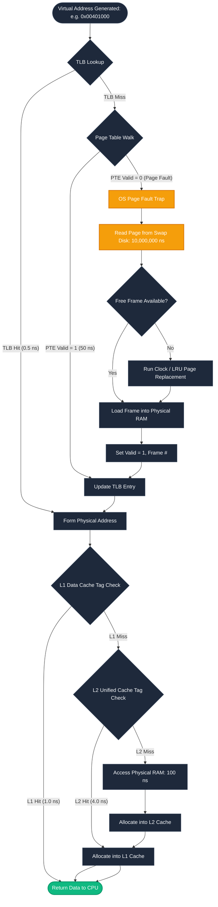

<div align="center">

# 🧠 MemSim Studio (Memora Lab)
### The Ultimate Interactive Computer Organization & Operating Systems Memory Platform

[](https://memora-lab.vercel.app)
[](#)
[](#)
[](#)
[](#)

<p align="center">
  <b>Bridging Silicon Microarchitecture &amp; Operating System Kernels in Real Time</b><br>
  Explore Cache Hierarchies (L1/L2), TLB Hit/Miss Walks, Paging, Page Fault Traps, Swapping, Heap Allocation, and Fragmentation with a Live Detective Narrator.
</p>

```
  ┌────────────────────────────────────────────────────────────────────────────────────────┐
  │                                                                                        │
  │   [CPU: Virtual Address]                                                               │
  │              │                                                                         │
  │              ▼                                                                         │
  │   ┌──────────────────────┐         TLB Miss         ┌──────────────────────────────┐   │
  │   │  TLB Translation     │ ───────────────────────► │   Page Table Walk (DRAM)     │   │
  │   │  (0.5 ns Associative)│                          │   (50 ns Latency)            │   │
  │   └──────────┬───────────┘                          └──────────────┬───────────────┘   │
  │              │ TLB Hit                                             │ Page Fault        │
  │              ▼                                                     ▼                   │
  │   ┌──────────────────────┐                          ┌──────────────────────────────┐   │
  │   │ Physical Address Gen │ ◄─────────────────────── │   Swap Disk Trap Handler     │   │
  │   └──────────┬───────────┘      Page Brought In     │   (10,000,000 ns Latency)    │   │
  │              │                                      └──────────────────────────────┘   │
  │              ▼                                                                         │
  │   ┌──────────────────────┐         L1 Miss          ┌──────────────────────────────┐   │
  │   │  L1 Data Cache       │ ───────────────────────► │   L2 Unified Cache           │   │
  │   │  (1.0 ns Latency)    │                          │   (4.0 ns Latency)           │   │
  │   └──────────┬───────────┘                          └──────────────┬───────────────┘   │
  │              │ L1 Hit                                              │ L2 Miss           │
  │              ▼                                                     ▼                   │
  │   ┌──────────────────────┐                          ┌──────────────────────────────┐   │
  │   │ CPU Execution Unit   │ ◄─────────────────────── │   Main Memory (RAM)          │   │
  │   │ (Data Returned)      │       RAM Data Load      │   (100 ns Latency)           │   │
  │   └──────────────────────┘                          └──────────────────────────────┘   │
  │                                                                                        │
  └────────────────────────────────────────────────────────────────────────────────────────┘
```

<br>

<a href="https://memora-lab.vercel.app">
  
</a>

<br><br>

---

### 👨‍💻 Engineering & Development Team
Developed and engineered by:
* 🌟 **Krishna Agarwal**
* 🌟 **Ayush Singh**
* 🌟 **Divyanshu Gautam**

---

</div>

## 📑 Table of Contents
1. [🌟 Executive Overview](#-executive-overview)
2. [🌐 Live Deployment](#-live-deployment)
3. [🛣️ Lab 1: The Memory Journey & Detective Narrator](#️-lab-1-the-memory-journey--detective-narrator)
4. [⚡ Lab 2: Cache Architecture Lab (L1 & L2)](#-lab-2-cache-architecture-lab-l1--l2)
5. [📄 Lab 3: Virtual Memory, Paging & Swapping](#-lab-3-virtual-memory-paging--swapping)
6. [🧩 Lab 4: Memory Allocation & Fragmentation](#-lab-4-memory-allocation--fragmentation)
7. [📐 Lab 5: Dynamic Bit Anatomy Calculator](#-lab-5-dynamic-bit-anatomy-calculator)
8. [📖 Lab 6: Memory Theory & Architecture Encyclopedia](#-lab-6-memory-theory--architecture-encyclopedia)
9. [🧮 Theoretical Formulations & Equations](#-theoretical-formulations--equations)
10. [🏗️ Software Architecture & Project Structure](#️-software-architecture--project-structure)
11. [🚀 How to Run Locally & Deploy](#-how-to-run-locally--deploy)
12. [👥 Creators & Contributors](#-creators--contributors)
13. [📄 License](#-license)

---

## 🌟 Executive Overview

In conventional undergraduate and graduate Computer Science curricula, **Computer Organization & Architecture (COA)** and **Operating Systems (OS)** are taught in separate silos:
* **COA courses** focus on silicon gates, SRAM cache sets, tag comparisons, and AMAT equations.
* **OS courses** focus on page tables, translation lookaside buffers (TLBs), page fault interrupts, clock second-chance replacement, and heap fragmentations.

In a physical CPU, these layers are **deeply intertwined and operate concurrently**. A single memory load instruction (`lw $t0, 0($sp)`) triggers a cascading journey across silicon latches, associative hardware tables, page tables, OS kernel traps, and mechanical/solid-state swap disk sectors.

**MemSim Studio (Memora Lab)** unifies both worlds into a single, cohesive, zero-dependency visual simulator running natively in the browser with high-performance modular JavaScript.

---

## 🌐 Live Deployment

The platform is continuously built and deployed on Vercel's global edge network:

```
🔗 Production URL: https://memora-lab.vercel.app
```

> **Instant Access:** Compatible with Google Chrome, Mozilla Firefox, Apple Safari, Microsoft Edge, and Opera without any plugins, external installs, or build-step dependencies.

---

## 🛣️ Lab 1: The Memory Journey & Detective Narrator

The flagship view models the complete hardware datapath of an instruction in motion:



### 🕵️ The "Detective" Hardware Narrator
Translates raw hexadecimal values and cache tags into clear, human-readable forensic narratives:
* Breaks down every step chronologically: VPN extraction, TLB tag matching, Page Table status, Frame generation, L1 Set Indexing, and L2 allocation.
* Quantifies the latency impact of each step and computes the **Accumulated Access Time**.
* Automatically detects loop patterns and temporal/spatial locality re-use.

---

## ⚡ Lab 2: Cache Architecture Lab (L1 & L2)

Provides an interactive x-ray into multi-level associative cache memories.

```
  Virtual Address Breakdown (32-Bit):
  ┌───────────────────────────────┬─────────────────┬──────────────────────┐
  │         TAG BITS              │  SET INDEX BITS │  BLOCK OFFSET BITS   │
  │     [31 ........... 10]       │   [9 ....... 5] │    [4 .......... 0]  │
  └───────────────────────────────┴─────────────────┴──────────────────────┘
                 │                         │                    │
                 │ Compare Tag             ▼ Select Set         ▼ Byte in Line
                 ▼                  ┌───────────────┐
         ┌───────────────┐          │ Set 0: Way 0/1│
         │ Tag Comparator│ ◄─────── │ Set 1: Way 0/1│
         └───────┬───────┘          │      ...      │
                 ▼                  │ Set N: Way 0/1│
         [HIT / MISS Signal]        └───────────────┘
```

### Configurable Parameters
* **Cache Geometries:** Direct-Mapped ($1$-Way), $2$-Way Set Associative, $4$-Way Set Associative, and Fully Associative.
* **Block Sizes:** $16$ Bytes, $32$ Bytes, $64$ Bytes, $128$ Bytes.
* **Replacement Policies:** 
  * **LRU (Least Recently Used):** High hit rates via age counter tracking.
  * **FIFO (First-In, First-Out):** Queue-based eviction without reference age.
  * **LFU (Least Frequently Used):** Access frequency frequency tracking.
* **Write Policies:** 
  * **Write-Back + Write-Allocate:** Minimizes bus traffic via dirty bits.
  * **Write-Through + No-Write-Allocate:** Keeps RAM updated continuously.
* **The 3 C's Miss Classification:**
  * 🧊 **Compulsory (Cold):** First time this block has ever been accessed.
  * 📦 **Capacity:** Cache is physically full; would have been saved with infinite size.
  * 💥 **Conflict:** Multiple active addresses contend for the same set index.

---

## 📄 Lab 3: Virtual Memory, Paging & Swapping

Models the complete virtual-to-physical address translation engine managed by the Memory Management Unit (MMU) and OS Kernel.

```
  Virtual Address:
  ┌───────────────────────────────────────────────┬────────────────────────┐
  │       Virtual Page Number (VPN) - 20 Bits     │  Page Offset - 12 Bits │
  └──────────────────────┬────────────────────────┴────────────┬───────────┘
                         │                                     │
         ┌───────────────┴───────────────┐                     │
         ▼                               ▼                     │
  ┌──────────────┐              ┌─────────────────┐            │
  │  TLB Lookup  │ (Miss Walk)  │   Page Table    │            │
  │ [VPN | Frame]│ ───────────► │ [PTE: V|D|R|PFN]│            │
  └──────┬───────┘              └────────┬────────┘            │
         │ Hit                           │ Hit                 │
         └───────────────┬───────────────┘                     │
                         ▼ Physical Frame Number (PFN)         │
  ┌───────────────────────────────────────────────┬────────────┴───────────┐
  │         Physical Frame Number (PFN)           │  Page Offset - 12 Bits │
  └───────────────────────────────────────────────┴────────────────────────┘
  Physical Memory (RAM) Address
```

### Key Subsystems
1. **Fully Associative TLB:** Ultra-fast silicon buffer storing recent VPN $\rightarrow$ Frame translations with immediate hit/miss indicators.
2. **Page Table Entries (PTE):**
   * **Valid Bit ($V$):** Determines if the page is currently memory-resident or on swap disk.
   * **Dirty Bit ($D$):** Tracks whether write operations occurred, requiring a writeback upon eviction.
   * **Reference Bit ($R$):** Used by the page replacement engine.
   * **Swap Disk Sector:** Location of backing disk image.
3. **Interactive Clock (Second-Chance) Algorithm:**
   * Watch the visual clock hand rotate through memory frames in real time.
   * Inspects $R$-bits: if $R=1$, the bit is cleared ($R \leftarrow 0$) and the frame is given a second chance; if $R=0$, the frame is evicted!

---

## 🧩 Lab 4: Memory Allocation & Fragmentation

Demonstrates the trade-offs between variable-size contiguous heap partitioning and fixed-size page frames.

```
  Contiguous Heap Allocation & External Fragmentation:
  ┌──────────────┬──────────────┬──────────────┬──────────────┬──────────────┐
  │ Process A    │  FREE HOLE   │ Process B    │  FREE HOLE   │ Process C    │
  │ (Allocated)  │   (30 KB)    │ (Allocated)  │   (40 KB)    │ (Allocated)  │
  └──────────────┴──────────────┴──────────────┴──────────────┴──────────────┘
                                       ▲
              Incoming Allocation Request: Process D (50 KB)
              Total Free Space = 30 KB + 40 KB = 70 KB
              Result: ❌ ALLOCATION FAILS (External Fragmentation!)
```

### Core Features
* **Placement Strategies:**
  * **First-Fit:** Allocates into the first hole that satisfies the byte request. Fast, but leaves fragmented slivers at the top.
  * **Best-Fit:** Searches the entire free list to find the smallest hole that fits. Creates minuscule unusable slivers.
  * **Worst-Fit:** Allocates from the largest available hole, preserving moderate holes.
* **External Fragmentation Simulator:** Demonstrates failures where total free memory exceeds request size, but lacks contiguity.
* **Interactive 1-Click Memory Compaction:** Shifts all allocated blocks down in physical memory, coalescing scattered holes into one unified free block.
* **Internal Fragmentation Calculator:** Contrasts contiguous allocation with Paging, illustrating waste inside the final fixed 4 KB page frame.

---

## 📐 Lab 5: Dynamic Bit Anatomy Calculator

Real-time interactive mathematical slider laboratory for hardware architectural parameters:

| Parameter | Slider Range | Formula |
| :--- | :--- | :--- |
| **Cache Capacity** | $128\text{ B}$ to $64\text{ KB}$ | $C$ |
| **Block Size ($B$)** | $8\text{ B}$ to $256\text{ B}$ | $\text{Offset Bits} = \log_2(B)$ |
| **Associativity ($W$)** | $1\text{ (Direct)}$ to $16\text{-Way}$ | $\text{Index Bits} = \log_2(C / (B \times W))$ |
| **Address Width** | $32\text{ Bits}$ | $\text{Tag Bits} = 32 - (\text{Index} + \text{Offset})$ |
| **Page Size ($P$)** | $1\text{ KB}$ to $64\text{ KB}$ | $\text{Page Offset} = \log_2(P)$ |
| **Virtual Space** | $32\text{-Bit Virtual}$ | $\text{VPN Bits} = 32 - \log_2(P)$ |

---

## 📖 Lab 6: Memory Theory & Architecture Encyclopedia

A searchable, college-level architectural reference integrated directly within the application:

1. **The Memory Hierarchy & The Memory Wall:** Why processor speeds outgrew DRAM latencies by 55% vs 7% annually between 1980–2005.
2. **Quantitative AMAT:** Single-level and multi-level formulations with temporal/spatial locality optimization strategies.
3. **CPU Caches & Associativity Trade-offs:** Detailed analysis of Direct-Mapped vs Set-Associative vs Fully-Associative caches, hit times, hardware comparator costs, and write buffers.
4. **Virtual Memory & MMU:** Memory protection, isolation, address translation mechanics, and Page Table Entry (PTE) flags.
5. **Paging & Fault Lifecycle:** The complete 7-step hardware interrupt and OS trap sequence, working set model, and Bélády's Anomaly.
6. **Heap Memory Allocation:** `malloc`/`free`, `brk`/`sbrk`, boundary tags, implicit vs explicit free lists, and buddy allocation.
7. **Physical Silicon Hardware:** 6T SRAM bistable cross-coupled inverters vs 1T-1C DRAM capacitive storage, refresh cycles, and Direct Memory Access (DMA).
8. **Non-Volatile ROM Taxonomy:** In-depth matrix comparing Masked ROM, PROM, EPROM, EEPROM, NOR Flash, and NAND Flash, including erase physics and the cold-boot vector (`0xFFFFFFF0`).

---

## 🧮 Theoretical Formulations & Equations

### 1. Average Memory Access Time (AMAT)
$$\text{AMAT} = t_{\text{hit}} + (\text{Miss Rate} \times \text{Miss Penalty})$$

For a two-level cache hierarchy with main RAM:
$$\text{AMAT} = t_{L1} + M_{L1} \times \left( t_{L2} + M_{L2} \times t_{\text{RAM}} \right)$$

### 2. Effective Memory Access Time (EMAT) with TLB
$$\text{EMAT} = \alpha \cdot (t_{\text{TLB}} + t_{\text{RAM}}) + (1 - \alpha) \cdot (t_{\text{TLB}} + 2 \cdot t_{\text{RAM}})$$
*Where $\alpha$ is the TLB Hit Rate.*

When page faults are considered with page fault rate $p$:
$$\text{Effective Access Time} = (1 - p) \cdot \text{Memory Latency} + p \cdot \text{Page Fault Service Time}$$

### 3. Cache Line Address Decomposition
$$\text{Offset Bits} = \log_2(\text{Block Size})$$
$$\text{Index Bits} = \log_2\left(\frac{\text{Total Cache Size}}{\text{Block Size} \times \text{Set Associativity}}\right)$$
$$\text{Tag Bits} = 32 - (\text{Index Bits} + \text{Offset Bits})$$

---

## 🏗️ Software Architecture & Project Structure

The project is built on clean Object-Oriented ES6 JavaScript without external frameworks or bundle overhead:

```
Memory-Simulator/
├── 📄 index.html              # Core application entrypoint, semantic layout & DOM views
├── 📄 README.md                # Comprehensive architectural handbook & project documentation
│
├── 📂 css/
│   └── 🎨 style.css           # Glassmorphic dark design system, glowing accents, and responsive layout
│
└── 📂 js/
    ├── 🚀 app.js              # Application coordinator, DOM event dispatcher & tab controller
    │
    ├── 📂 engine/             # Headless algorithmic simulation engines
    │   ├── ⚙️ simulator.js    # Master pipeline orchestrator & AMAT latency calculator
    │   ├── ⚡ cache.js        # L1/L2 Cache simulator, sets, ways, 3 C's classifier & replacement
    │   ├── 📄 paging.js       # TLB, multi-entry Page Table, Page Fault handler & Clock algorithm
    │   └── 🧩 allocator.js    # Dynamic contiguous heap manager, fragmentation & compaction
    │
    └── 📂 ui/                 # View rendering components & interactive monitors
        ├── 🛣️ pipelineView.js # Interactive hardware datapath visualizer
        ├── 🕵️ narrator.js     # Detective forensic explanation panel
        ├── 🧪 labsView.js     # Cache, Paging, Fragmentation & Bit Anatomy laboratory views
        └── 📖 theoryView.js   # Memory architecture encyclopedia & AMAT calculator
```

---

## 🚀 How to Run Locally & Deploy

Because MemSim uses modern native ES6 modules (`type="module"`), browsers require it to be served via HTTP/HTTPS (to respect CORS security on module imports).

### Method 1: Python Built-In Server (Easiest)
```bash
# Clone the repository
git clone https://github.com/your-username/Memory-Simulator.git
cd Memory-Simulator

# Start Python 3 HTTP server on port 8080
python -m http.server 8080
```
Open your browser at `http://localhost:8080`.

### Method 2: Node.js / NPX
```bash
npx serve .
```

### Method 3: VS Code / Live Server
1. Open the project folder in **Visual Studio Code**.
2. Right-click `index.html` and click **"Open with Live Server"**.

### Method 4: Deploying to Vercel
Deploy your own instance to Vercel in seconds with zero configuration:
```bash
npm install -g vercel
vercel
```

---

## 👥 Creators & Contributors

MemSim Studio was designed, engineered, and built with 💙 by:

<div align="center">

| Contributor |
| :--- |
| **Krishna Agarwal** |
| **Ayush Singh** |
| **Divyanshu Gautam** |

</div>

<br>

---

## 📄 License

This project is licensed under the **MIT License** — you are free to use, modify, distribute, and integrate this software into academic lectures, research, and educational platforms.

---

<div align="center">
  <sub>Built for students, educators, and systems engineers worldwide.</sub><br>
  <b><a href="https://memora-lab.vercel.app">Launch MemSim Studio (memora-lab.vercel.app) ↗</a></b>
</div>
